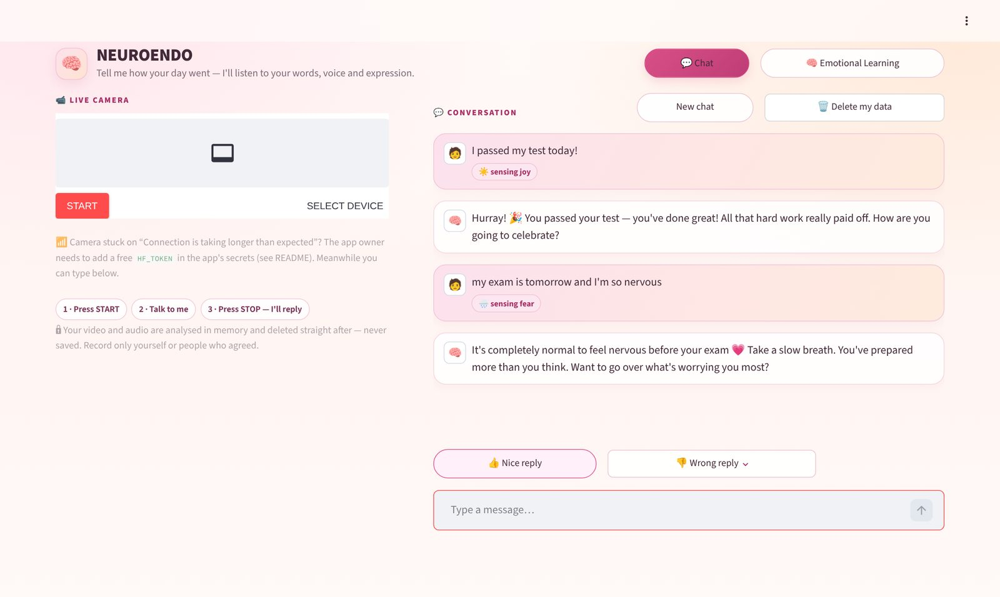
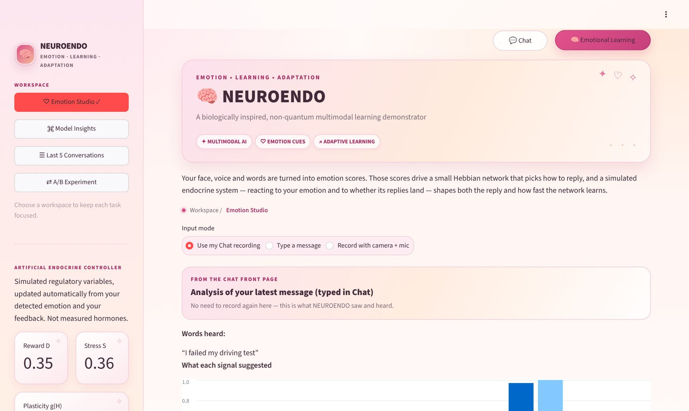
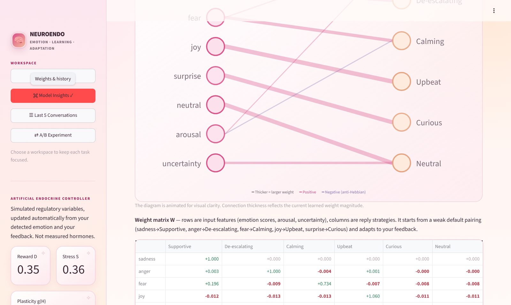
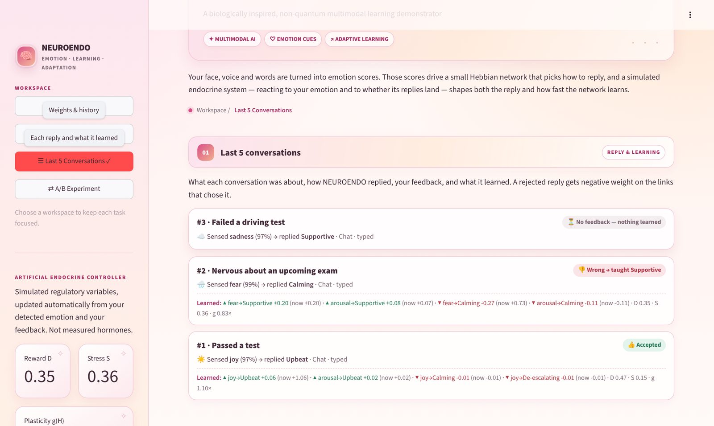
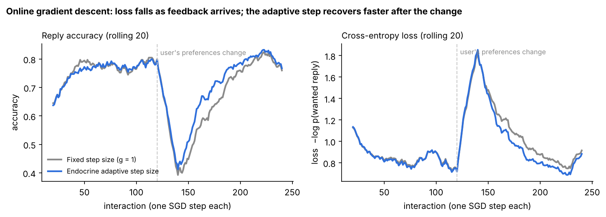
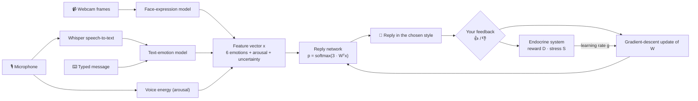
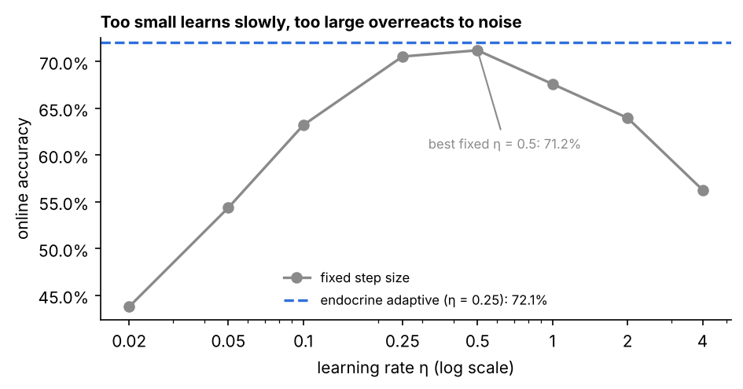
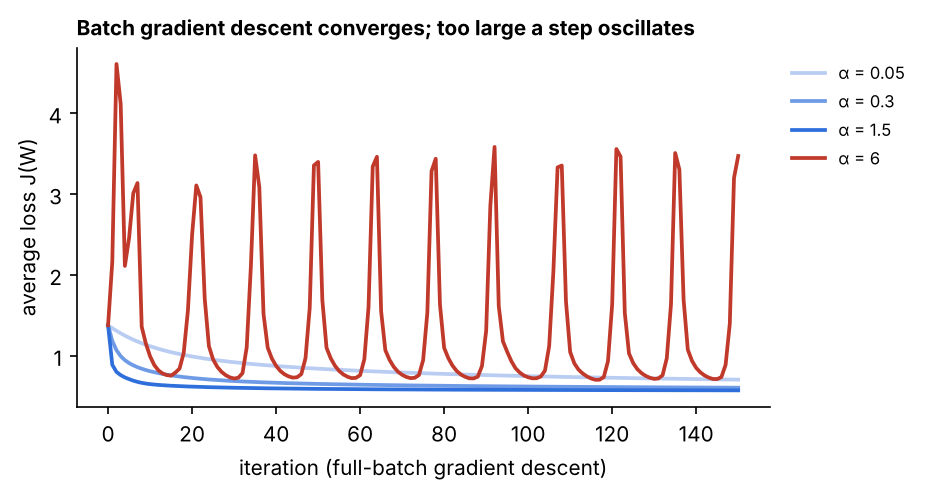

<h1 align="center">🧠 NEUROENDO</h1>

<p align="center">
  <strong>An emotion-aware chat assistant that learns how you like to be answered.</strong><br>
  Face, voice and words → emotion scores → a reply in the right tone → learning from your feedback,<br>
  with an <em>artificial endocrine system</em> that tunes how fast it learns. Fully classical (non-quantum).
</p>

<p align="center">
  <a href="https://w86xa6kmovy4t9vgyt9t79.streamlit.app"></a>
  
  
  
  
  
</p>

<p align="center">
  <a href="https://w86xa6kmovy4t9vgyt9t79.streamlit.app"><b>Try it live</b></a> ·
  <a href="#-features">Features</a> ·
  <a href="#-how-it-works">How it works</a> ·
  <a href="#-gradient-descent-results">Results</a> ·
  <a href="#-run-locally">Run locally</a> ·
  <a href="#-security-and-privacy">Privacy</a>
</p>

<p align="center">
  
</p>

> **Example:** you say *"I passed my test today!"* → NEUROENDO senses **joy** and replies *"Hurray! 🎉 You passed your test — you've done great!"*.
> If you'd rather get a different kind of reply, press **👎 Wrong reply**, pick a tone, and it learns your preference.

<details>
<summary><b>Table of contents</b></summary>

- [Features](#-features)
- [Screenshots](#-screenshots)
- [Using the app](#-using-the-app)
- [How it works](#-how-it-works)
- [Gradient descent results](#-gradient-descent-results)
- [Tech stack](#-tech-stack)
- [Project structure](#-project-structure)
- [Run locally](#-run-locally)
- [Deploy on Streamlit Cloud](#-deploy-on-streamlit-cloud)
- [Security and privacy](#-security-and-privacy)
- [Limitations](#-limitations)
- [Roadmap](#-roadmap)
- [Author and acknowledgements](#-author-and-acknowledgements)

</details>

## ✨ Features

| | |
|---|---|
| 🎥 **Multimodal emotion sensing** | Webcam expression, speech (Whisper) and text are fused into six emotion scores: sadness, anger, fear, joy, surprise, neutral. |
| 💬 **Replies that fit the moment** | Six reply styles (Supportive, De-escalating, Calming, Upbeat, Curious, Neutral) and replies about real life events: passing or failing a test, a new job, a break-up, exam nerves and more. |
| 📈 **Learns from you** | Every 👍 / 👎 is one step of **gradient descent** on a cross-entropy loss. Wrong replies get negative weights. |
| 🧪 **Artificial endocrine system** | Simulated *stress* and *reward* levels raise the learning rate after mistakes and lower it when replies are working. |
| 🔍 **See inside the model** | Live weight network, hormone levels, the last 5 conversations with what each one taught the model, and an A/B experiment. |
| 🔒 **Private by design** | Video and audio are analysed in memory and deleted straight away; one click deletes your data; an optional password gate. |

## 📸 Screenshots

<table>
  <tr>
    <td width="50%"><br><sub><b>Emotion Studio</b>: the analysis of your latest message, without recording again.</sub></td>
    <td width="50%"><br><sub><b>Model Insights</b>: the learned network and weight matrix (positive and negative links).</sub></td>
  </tr>
  <tr>
    <td width="50%"><br><sub><b>Last 5 Conversations</b>: what each chat was about, your feedback and which weights changed.</sub></td>
    <td width="50%"><br><sub><b>Learning curves</b>: loss falls as feedback arrives, and the adaptive rate recovers faster after a change.</sub></td>
  </tr>
</table>

## 🧭 Using the app

Two buttons in the top-right corner switch views.

**💬 Chat** (front page)

1. Press **START** on the camera and allow camera and microphone access.
2. Talk about your day, then press **STOP**. Analysis starts automatically.
3. Your words appear with the emotion NEUROENDO sensed, followed by its reply.
4. Press **👍 Nice reply**, or **👎 Wrong reply** and choose a better tone. It answers again in that tone and learns.

No camera? Just type in the message box.

**🧠 Emotional Learning**: the full research view, with four workspaces.

| Workspace | What you'll find |
|---|---|
| ♡ **Emotion Studio** | Type, record, or reuse your Chat recording; see the emotion breakdown, the reply-strategy scores and the reply; accept or correct it |
| ✧ **Model Insights** | Hormone levels, how the latest message was analysed, the weight network and matrix, and learning history |
| ☰ **Last 5 Conversations** | A short title per conversation, emotion → reply style, your feedback and the weights that went up or down |
| ⇄ **A/B Experiment** | Plain vs endocrine learning on simulated users whose preferences change half-way |

Both views share one model, so feedback in either one is learned by the same network.

## 🧠 How it works



**1. Sensing emotion.** Sampled webcam frames go to a pretrained facial-expression model ([`trpakov/vit-face-expression`](https://huggingface.co/trpakov/vit-face-expression)). Speech is cleaned up (hum filter, 16 kHz, silence trimmed) and transcribed with Whisper `base.en`, then classified by a text-emotion model ([`j-hartmann/emotion-english-distilroberta-base`](https://huggingface.co/j-hartmann/emotion-english-distilroberta-base)). A typo-tolerant keyword fallback is used if that model can't load. Text and face are fused 65 / 35, and uncertainty rises when signals are missing or disagree.

**2. Choosing a reply.** A weight matrix **W** (8 inputs × 6 reply styles = 48 weights) scores each style, and a softmax turns the scores into probabilities. W starts from a sensible default (sadness → Supportive, anger → De-escalating, fear → Calming, joy → Upbeat, surprise → Curious), so replies make sense from the first message. If you mention a recognised life event, the reply talks about it.

**3. Learning by gradient descent.** Each piece of feedback is one step of stochastic gradient descent on the cross-entropy loss $L = -\log p_y$:

$$
\frac{\partial L}{\partial W} = 3\,x\,(p - y)^{\top}
\qquad\Longrightarrow\qquad
\Delta W = \eta\, g\; x\,(y - p)^{\top}, \quad \eta = 0.25
$$

The weight to the reply you wanted goes up, and the weights to replies the model wrongly preferred go down. A rejected reply also gets a small extra push down, so wrong answers end up with negative weights. Weights stay within [−3, 3].

**4. Artificial endocrine system.** Two hormone-like levels set the learning rate:

$$
g = \text{clip}\,(1 + 2S - D,\; 0.2,\; 2.0)
$$

**Stress S** rises when replies are rejected (and when you sound distressed), so the model re-learns faster. **Reward D** rises when replies are accepted (and when you sound happy), so it learns more carefully and isn't thrown off by one accidental click. These are simulated variables, not measured hormones.

## 📊 Gradient descent results

Tested on simulated users with noisy emotions, 10% random feedback, and preferences that **change half-way through**:

| Method (100 simulated users) | Reply accuracy |
|---|---|
| No learning (fixed default rule) | 36.5% |
| Gradient descent, fixed learning rate | 71.1% |
| **Gradient descent, endocrine adaptive learning rate** | **72.4%** (better for 82 of 100 users) |

<table>
  <tr>
    <td width="50%"><br><sub>Too small a learning rate learns slowly; too large over-reacts to noise.</sub></td>
    <td width="50%"><br><sub>Batch gradient descent converges; a far-too-large step oscillates.</sub></td>
  </tr>
</table>

The analytic gradient matches a numerical check to 2.3 × 10⁻⁹, and the app's update equals one gradient-descent step exactly. To reproduce every number and figure (about 10 seconds):

```bash
python analysis/gradient_descent_report.py     # writes analysis/figures/*.png and analysis/results.json
```

## 🧰 Tech stack

| Layer | Tools |
|---|---|
| App and UI | [Streamlit](https://streamlit.io), [streamlit-webrtc](https://github.com/whitphx/streamlit-webrtc) for live camera and mic |
| Emotion models | Hugging Face Transformers: Whisper, DistilRoBERTa text emotion, ViT face expression |
| Vision and audio | OpenCV, SciPy, Pillow |
| Learning core | NumPy: softmax, cross-entropy, gradient descent, endocrine learning rate |
| Analysis | NumPy, SciPy, Matplotlib |

## 📁 Project structure

```text
.
├── app.py                         # Streamlit UI: Chat view + Emotional Learning workspaces
├── neuroendo/
│   ├── learning.py                # Reply network, gradient-descent update, endocrine system, A/B test
│   ├── emotion.py                 # Speech, text, face and audio analysis; fusion and uncertainty
│   ├── replies.py                 # Life-event detection (negation-aware) and reply wording
│   ├── media.py                   # In-memory webcam/microphone capture, wiped after use
│   └── security.py                # Escaping, data wiping, idle timeout, login throttling
├── analysis/
│   ├── gradient_descent_report.py # Gradient checks, experiments and figures
│   ├── figures/                   # Generated charts
│   └── results.json               # Generated numbers
├── docs/screenshots/              # Images used in this README
├── .streamlit/
│   ├── config.toml                # Security-focused server settings
│   └── secrets.toml.example       # Template for HF_TOKEN / APP_PASSWORD
├── ARCHITECTURE.md                # Module responsibilities and data flow
└── requirements.txt
```

## 🚀 Run locally

```bash
git clone https://github.com/sumanbhatbtech25-beep/Emotional-Intelligence.git
cd Emotional-Intelligence
python -m venv .venv
source .venv/bin/activate          # Windows PowerShell: .\.venv\Scripts\Activate.ps1
pip install -r requirements.txt
streamlit run app.py
```

Open the address Streamlit prints (usually http://localhost:8501). The first analysis is slower while the pretrained models download.

## 🌐 Deploy on Streamlit Cloud

1. On [Streamlit Community Cloud](https://share.streamlit.io/), create an app from this repository with `app.py` as the entry point.
2. **Make the live camera work.** Most home, college and mobile networks block direct browser-to-server video, so the camera hangs on *"Connection is taking longer than expected"*. Add a free relay token:
   - On [huggingface.co](https://huggingface.co): **Settings → Access Tokens → Create new token** (type **Read**).
   - In the app's **Settings → Secrets**, add `HF_TOKEN = "hf_..."` and save.
3. *(Recommended)* Add a shared password in the same secrets box: `APP_PASSWORD = "a-long-unique-passphrase"`.

<details>
<summary>More secrets options</summary>

See [`.streamlit/secrets.toml.example`](.streamlit/secrets.toml.example):

- Cloudflare or Twilio TURN credentials instead of `HF_TOKEN`.
- `WHISPER_MODEL = "openai/whisper-small.en"` for better speech recognition on a bigger server.

The real `secrets.toml` is git-ignored, so it can't be committed by accident.

</details>

## 🔒 Security and privacy

- 🎥 **Recordings are never saved.** Video and audio are held in memory only and wiped as soon as they've been analysed, even if analysis fails. No images are kept.
- 🗑️ **Delete my data** erases your messages, transcripts and analysis in one click. Inactive sessions are wiped after 30 minutes.
- 👥 **Sessions are isolated.** No visitor can see another visitor's data.
- 🔑 **Password gate (optional):** constant-time checks, lockout after 5 wrong attempts in 15 minutes, 8-hour sign-ins, and logout wipes the session.
- 🛡️ **Hardened server:** no error details shown to visitors, developer menu hidden, XSRF/CORS protection on, and all user text shown as plain text (no HTML or link injection).

<details>
<summary>What this does not cover</summary>

- The video link is set up through Google's public STUN server, which sees your IP address (standard for browser video calls); the media itself is encrypted (DTLS-SRTP).
- Run the app over HTTPS (Streamlit Cloud does); browsers block the camera on plain HTTP except on localhost.
- Models are downloaded from Hugging Face on first use; pin model revisions for stricter supply-chain control.
- The shared password is one secret for everyone, not individual accounts.

</details>

## 🚧 Limitations

- Emotion scores are uncertain cues, not diagnoses or proof of how someone feels.
- Replies are written templates per style and life event, not generated by a language model.
- Learning lasts for the current session only and is not shared between users.
- Results come from simulated users; testing with real users is future work.
- Record only yourself or people who have agreed.

## 📌 Roadmap

- [ ] Evaluate with real users' feedback (with consent)
- [ ] A second "hormone" that controls exploration, so the assistant tries other styles after mistakes
- [ ] Optional, opt-in memory of preferences between sessions
- [ ] Generated replies from a small language model, guided by the chosen style
- [ ] A better mobile layout

## 👤 Author and acknowledgements

Built by **Suman Bhat** ([@sumanbhatbtech25-beep](https://github.com/sumanbhatbtech25-beep)).

Thanks to the open-source projects this builds on: [Streamlit](https://streamlit.io), [streamlit-webrtc](https://github.com/whitphx/streamlit-webrtc), [Hugging Face Transformers](https://github.com/huggingface/transformers), [OpenAI Whisper](https://github.com/openai/whisper), and the model authors of [`j-hartmann/emotion-english-distilroberta-base`](https://huggingface.co/j-hartmann/emotion-english-distilroberta-base) and [`trpakov/vit-face-expression`](https://huggingface.co/trpakov/vit-face-expression).

---

<p align="center"><sub>Sense the emotion ✦ Learn from feedback ✦ Question the results</sub></p>
